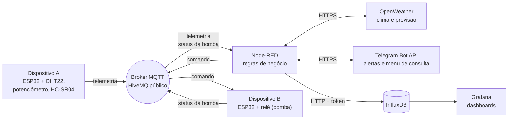

# SmartFarm

Irrigação automatizada de precisão com IoT para o uso eficiente da água, alinhada à **ODS 6, meta 6.4 da Agenda 2030 da ONU**.

Projeto da disciplina **Objetos Inteligentes Conectados** — Faculdade de Computação e Informática, Universidade Presbiteriana Mackenzie.
Professor: Wallace Rodrigues de Santana.

**Equipe:** Henrique Storai · Gabriel Athia · Pedro Kihara

> 🎥 **Vídeo de demonstração:** https://www.youtube.com/watch?v=qSY8k8FFGFU&feature=youtu.be
> 🔌 **Simulação no Wokwi:** [https://wokwi.com/projects/481041963496115201](#) · [https://wokwi.com/projects/481041940209331201](#)

---

## O problema

A agricultura responde por 72% das retiradas de água doce no mundo, principalmente para irrigação (FAO, 2021). No Brasil, a irrigação foi o principal uso da água em 2022, com 50,5% de todo o volume retirado (ANA, 2024). Boa parte dessa água é aplicada por rotinas de horário fixo, que irrigam mesmo quando o solo ainda está úmido ou quando vai chover.

## A proposta

O SmartFarm decide **quando irrigar com base na condição real do solo**:

- liga a bomba só quando a umidade do solo cai abaixo de 30% e desliga ao chegar a 60%;
- adia a irrigação quando a previsão do tempo indica chuva;
- protege o reservatório, bloqueando a bomba quando o nível fica crítico;
- registra o tempo de cada acionamento para estimar o volume de água usado e compará-lo com uma rotina fixa — o indicador de eficiência da meta 6.4;
- envia alertas pelo Telegram e mostra tudo em dashboards no Grafana;
- responde a consultas por um [bot no Telegram](docs/bot-telegram.md), com menu de botões: status geral, umidade, nível do reservatório, chuva prevista, estado da bomba e economia de água.

> 📄 **Artigo:** [SmartFarm-Artigo-N1.pdf](docs/SmartFarm-Artigo-N1.pdf) ([versão .docx](docs/SmartFarm-Artigo-N1.docx))

## Arquitetura



Todos os tópicos começam com `mack10308763/smartfarm/` ([detalhes](docs/topicos-mqtt.md)).

| Bloco | Tecnologia | Onde roda |
|---|---|---|
| Dispositivos | 2 × ESP32 simulados no Wokwi | Wokwi (rede Wokwi-GUEST) |
| Broker MQTT | HiveMQ público, porta 1883 | `broker.hivemq.com` |
| Regras de negócio | Node-RED | computador da equipe (Docker) |
| Banco de dados | InfluxDB (séries temporais) | InfluxDB Cloud, plano gratuito |
| Dashboards | Grafana | Grafana Cloud, plano gratuito |
| APIs externas | OpenWeather, Telegram Bot API | serviços de terceiros |

## Estrutura do repositório

```
smartfarm/
├── README.md                      ← você está aqui
├── docs/
│   ├── arquitetura.md             onde roda cada serviço e fluxo dos dados
│   ├── topicos-mqtt.md            tópicos e formato das mensagens JSON
│   ├── regras-de-negocio.md       regras R1 a R7 e como validá-las
│   ├── banco-de-dados.md          o que é gravado no InfluxDB
│   ├── dashboards.md              dashboards e painéis do Grafana
│   ├── bot-telegram.md            comandos do bot, segurança e configuração
│   ├── SmartFarm-Artigo-N1.docx   artigo do projeto (primeira entrega, corrigida)
│   ├── SmartFarm-Artigo-N1.pdf    o mesmo artigo em PDF, para leitura no navegador
│   └── img/                       diagramas e capturas de tela
├── dispositivos/
│   ├── README.md                  ligações, adaptações e como usar no Wokwi
│   ├── dispositivo-a-sensores/    sketch.ino, diagram.json e libraries.txt (Wokwi)
│   └── dispositivo-b-atuador/     sketch.ino, diagram.json e libraries.txt (Wokwi)
├── node-red/
│   ├── flows.json                 fluxo completo do Node-RED, sem credenciais
│   └── README.md                  instalação local, configuração e importação
├── grafana/
│   ├── dashboard-monitoramento.json        (a adicionar)
│   ├── dashboard-historico-alertas.json    (a adicionar)
│   └── README.md                  como importar e configurar a fonte de dados
├── .env.example                   variáveis secretas necessárias (sem valores reais)
├── .gitignore
└── LICENSE
```

Os arquivos marcados como "a adicionar" entram no repositório à medida que o protótipo for concluído.

## Como reproduzir o projeto

1. **Dispositivos** — crie dois projetos ESP32 no Wokwi e copie para cada um os arquivos `sketch.ino`, `diagram.json` e `libraries.txt` da pasta correspondente em [`dispositivos/`](dispositivos/). Eles já usam o broker `broker.hivemq.com`. As ligações e adaptações estão em [`dispositivos/README.md`](dispositivos/README.md).
2. **Banco de dados** — crie uma conta gratuita no [InfluxDB Cloud](https://cloud2.influxdata.com), um bucket `smartfarm` e dois tokens: um com leitura e escrita (Node-RED) e outro só de leitura (Grafana).
3. **Bot do Telegram** — crie o bot no @BotFather conforme [docs/bot-telegram.md](docs/bot-telegram.md).
4. **Node-RED** — rode o Node-RED no computador (Docker ou npm), informe as chaves e importe [`node-red/flows.json`](node-red/flows.json), seguindo [`node-red/README.md`](node-red/README.md).
5. **Grafana** — no Grafana Cloud, adicione o InfluxDB como fonte de dados (linguagem SQL) e importe os dois arquivos JSON de [`grafana/`](grafana/).
6. **Teste** — inicie as duas simulações no Wokwi e gire o potenciômetro abaixo de 30%: o Node-RED deve publicar o comando de ligar, o relé do Dispositivo B deve acionar e o acionamento deve aparecer no dashboard. Os demais testes estão em [docs/regras-de-negocio.md](docs/regras-de-negocio.md).

## Dados sensíveis

Chaves de API, tokens, IDs de chat e números de telefone **não** são publicados neste repositório. As chaves ficam só nas variáveis de ambiente do Node-RED de quem roda o projeto, o token do InfluxDB fica nas credenciais do Node-RED (que não são exportadas), e os valores necessários estão listados, sem conteúdo real, em [`.env.example`](.env.example).

## Referências

- AGÊNCIA NACIONAL DE ÁGUAS E SANEAMENTO BÁSICO (ANA). *Relatório Conjuntura dos Recursos Hídricos no Brasil atualiza informações sobre águas do País*. Brasília, DF: ANA, 2 fev. 2024.
- FOOD AND AGRICULTURE ORGANIZATION OF THE UNITED NATIONS (FAO). *The State of the World's Land and Water Resources for Food and Agriculture 2021: facts and figures*. Roma: FAO, 2021.
- ORGANIZAÇÃO DAS NAÇÕES UNIDAS (ONU). *Agenda 2030 para o Desenvolvimento Sustentável*. Nações Unidas Brasil, [s.d.].

## Licença

Distribuído sob a licença MIT. Veja [LICENSE](LICENSE).
