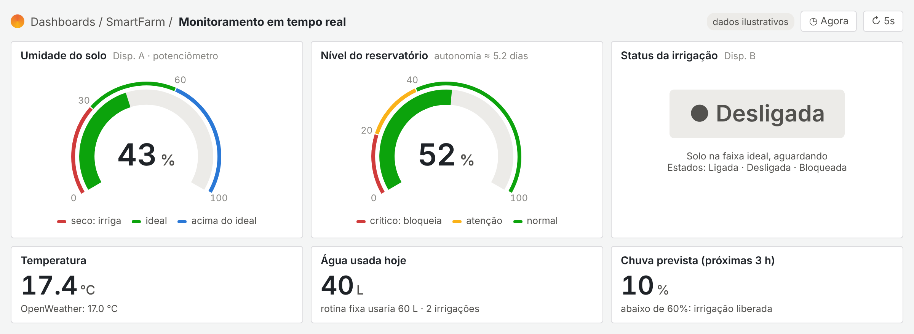
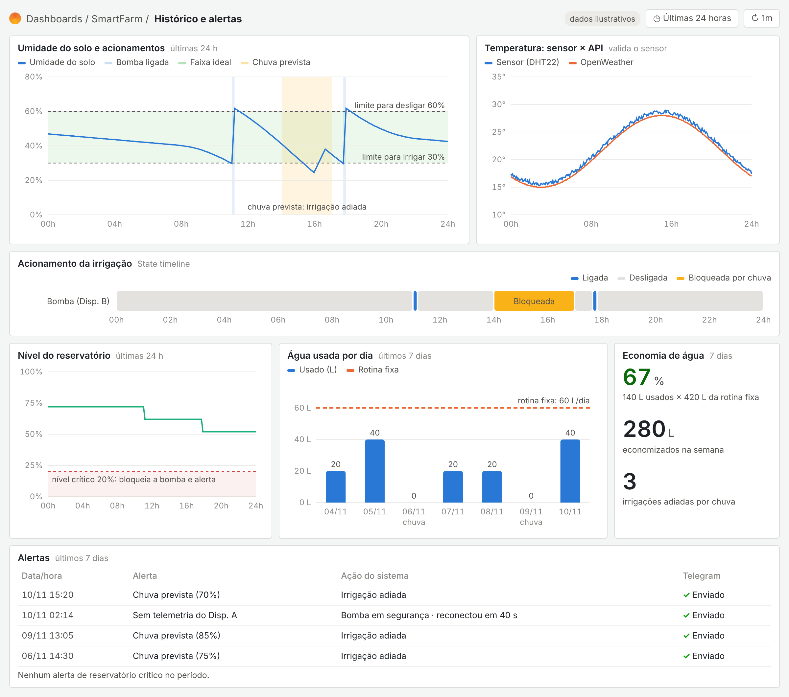

# Dashboards

São dois dashboards no Grafana, ambos usando o InfluxDB como fonte de dados. Cada painel responde a uma pergunta de quem acompanha o cultivo, e as cores usam os mesmos limites das [regras de negócio](regras-de-negocio.md).

Os arquivos para importação ficam na pasta [`grafana/`](../grafana/). As imagens abaixo são **esboços com dados ilustrativos**; as capturas reais serão adicionadas quando o protótipo estiver rodando.

## Dashboard 1 – Monitoramento em tempo real

Atualização a cada 5 segundos. Mostra a situação atual do campo.

| Painel | Tipo | Conteúdo |
|---|---|---|
| Umidade do solo | Gauge | % atual; vermelho < 30% (seco, irriga), verde 30–60% (ideal), azul > 60% |
| Nível do reservatório | Gauge | % atual; vermelho < 20% (bomba bloqueada), amarelo 20–40% (atenção), verde > 40%; autonomia estimada em dias |
| Status da irrigação | Stat | "Ligada" em verde, "Desligada" em cinza, "Bloqueada" em amarelo |
| Temperatura | Stat | °C medido pelo DHT22, com a temperatura do OpenWeather como referência |
| Água usada hoje | Stat | litros estimados, comparados ao que uma rotina fixa usaria |
| Chuva prevista (3 h) | Stat | probabilidade do OpenWeather |

## Dashboard 2 – Histórico e alertas

Últimas 24 horas, com alguns painéis de 7 dias. Mostra o que aconteceu e se o projeto está economizando água.

| Painel | Tipo | Conteúdo |
|---|---|---|
| Umidade do solo e acionamentos | Time series | umidade com as linhas de 30% e 60%, períodos de bomba ligada e de chuva prevista |
| Temperatura: sensor × API | Time series | DHT22 e OpenWeather no mesmo gráfico, para identificar falhas no sensor |
| Acionamento da irrigação | State timeline | bomba ligada, desligada ou bloqueada |
| Nível do reservatório | Time series | queda do nível e tendência de consumo, com a faixa crítica de 20% |
| Água usada por dia | Bar chart (7 dias) | litros por dia, com linha de referência da rotina fixa (2 × 15 min/dia) |
| Economia de água | Stat (7 dias) | % e litros economizados em relação à rotina fixa e irrigações adiadas por chuva — demonstra a meta 6.4 |
| Alertas | Table (7 dias) | data e hora, tipo, ação do sistema e confirmação de envio pelo Telegram |
