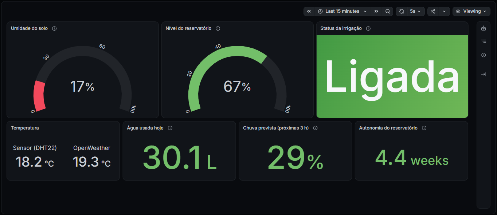
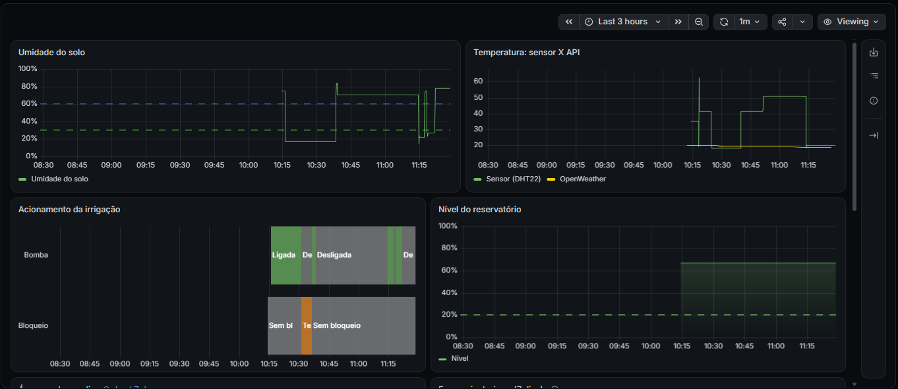
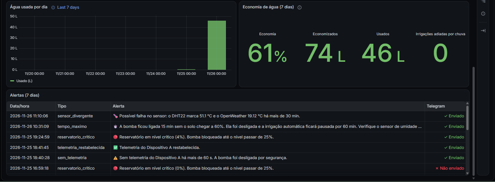

# Dashboards

São dois dashboards no Grafana Cloud, ambos lendo o InfluxDB Cloud com consultas SQL. Cada painel responde a uma pergunta de quem cuida da irrigação, e as cores seguem os mesmos limites das [regras de negócio](regras-de-negocio.md). Os arquivos para importação ficam na pasta [`grafana/`](../grafana/).

## A meta e como o dashboard mostra se ela está sendo atingida

A meta 6.4 da Agenda 2030 pede mais eficiência no uso da água. No SmartFarm, ela vira um indicador de propriedade: **quanto de água o sistema economiza em relação a uma rotina fixa** de duas irrigações diárias de 15 minutos (2 L/min × 30 min = 60 L por dia), contando só os dias em que o sistema esteve em operação.

A meta do projeto é **economizar pelo menos 30%**. No painel "Economia de água × meta de 30%", o percentual fica verde e aparece "Atingida" quando a economia é de 30% ou mais; fica vermelho e aparece "Não atingida" quando é menor.

Resultado dos testes (25 e 26/11/2026): 46 L usados contra 120 L da rotina fixa, ou seja, **61% de economia**, acima da meta.

## Dashboard 1 – Monitoramento em tempo real

Atualização a cada 5 segundos. Mostra a situação do campo agora.

| Painel | Pergunta que responde | Leitura |
|---|---|---|
| Umidade do solo | O campo precisa de água? | vermelho < 30% (seco, irriga), verde 30–60% (ideal), azul > 60% |
| Nível do reservatório | Há água para irrigar? | vermelho < 20% (bomba bloqueada), laranja 20–40% (atenção), verde > 40% |
| Status da irrigação | A bomba está funcionando? | Ligada (verde), Desligada (cinza) ou Bloqueada (laranja: chuva, reservatório, tempo máximo ou falha) |
| Temperatura | O sensor está confiável? | DHT22 ao lado do OpenWeather; uma diferença grande indica falha no sensor (R6) |
| Água usada hoje | Quanto já gastei hoje? | litros estimados; fica vermelho se passar dos 60 L da rotina fixa |
| Chuva prevista (3 h) | Vale esperar a chuva? | laranja a partir de 60%, quando a irrigação é adiada (R2) |
| Autonomia do reservatório | Por quanto tempo a água dura? | volume atual dividido pelo consumo médio dos últimos 7 dias |

## Dashboard 2 – Histórico e alertas

Últimas horas ou dias, com alguns painéis de 7 dias. Mostra o que aconteceu e se a meta está sendo atingida.

| Painel | Pergunta que responde |
|---|---|
| Umidade do solo (com linhas de 30% e 60%) | A umidade ficou na faixa ideal? Quantas vezes o solo secou? |
| Temperatura: sensor × API | Em que momento o sensor começou a divergir da realidade? |
| Acionamento da irrigação | Quando a bomba ligou, por quanto tempo e por que esteve bloqueada? |
| Nível do reservatório (com a linha de 20%) | Quanto falta para o nível crítico? |
| Água usada por dia (7 dias) | O consumo está subindo ou caindo? |
| Economia de água × meta de 30% | **A meta está sendo atingida?** |
| Alertas (7 dias) | O que deu errado, quando, e o aviso chegou ao Telegram? |

## Argumentos para defender os dashboards

1. **Cada painel responde a uma pergunta de decisão**, não é só um gráfico de dados. O primeiro dashboard é para agir agora (irrigar, esperar a chuva, verificar a bomba); o segundo é para avaliar o resultado.
2. **A meta está explícita.** O painel de economia compara o consumo real com uma referência (a rotina fixa) e com uma meta numérica (30%), e muda de cor conforme o resultado. Quem olha não precisa interpretar: verde é meta atingida, vermelho é meta não atingida.
3. **A comparação é justa.** A economia é calculada só sobre os dias em que o sistema funcionou, para não inflar o resultado comparando poucas horas de uso com uma semana inteira de rotina fixa.
4. **As cores seguem as regras de negócio.** Os 30% e 60% da umidade e os 20% do reservatório são os mesmos limites que ligam, desligam e bloqueiam a bomba, então o que o gestor vê é exatamente o que o sistema decide.
5. **Mostra também o que não funcionou.** A tabela de alertas registra se cada aviso chegou ao Telegram, e o painel de temperatura mostra quando o sensor diverge da API. Isso permite confiar nos números e identificar falhas.
6. **Separa operação de gestão.** Atualização de 5 segundos para o tempo real e janelas de 7 dias para o histórico, cada uma adequada ao seu uso.

## Esboços da primeira entrega

Os esboços apresentados na N1, com dados ilustrativos, continuam em [`img/esboco-dashboard-monitoramento.png`](img/esboco-dashboard-monitoramento.png) e [`img/esboco-dashboard-historico-alertas.png`](img/esboco-dashboard-historico-alertas.png).
